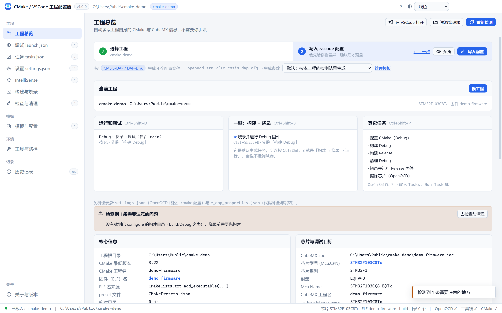

# CMake / VSCode 工程配置器

**自动读懂一个 CMake 工程，然后把它在 VSCode 里跑起来所需要的 `.vscode` 配置全部生成好。**

面向嵌入式开发（STM32 / Cortex-M），但**不限于 STM32** —— 通用 CMake 工程同样能用。



---

## 它解决什么问题

把一个 CMake 工程拖进 VSCode，想按 F5 就能烧录调试，你需要手写四个文件：

| 文件 | 不写会怎样 |
| --- | --- |
| `launch.json` | 没有调试配置，F5 弹「选择环境」 |
| `tasks.json` | 没有构建/烧录任务，`Ctrl+Shift+B` 没反应 |
| `settings.json` | cortex-debug 找不到 OpenOCD，报「openocd 不是内部或外部命令」 |
| `c_cpp_properties.json` | 头文件全红波浪线，`#include` 跳不过去 |

而这四个文件的内容**完全可以从工程本身推出来**：

- 固件名 → `CMakeLists.txt` 的 `add_executable()`
- 构建目录 → `CMakePresets.json` 的 `binaryDir`
- 芯片型号 → `.ioc` 文件的 `Mcu.CPN`
- OpenOCD target → 芯片系列 → `target/stm32f4x.cfg`
- 工具链路径 → 环境变量 / 系统 PATH / 常见安装位置

这个工具就是把这套推导过程做成图形界面，**检测 → 核对 → 一键写入**。

---

## 功能一览

- **工程检测** —— 自动找工程根（支持 VSCode 当前打开的 / 最近打开的 / 手输路径），读 CMake、CubeMX、现有 `.vscode` 配置
- **四类配置文件的可视化编辑** —— `launch.json` / `tasks.json` / `settings.json` / `c_cpp_properties.json`，改完即时生效，不用点保存
- **构建目标与源文件** —— 图形化改 `CMakeLists.txt`：把漏掉的源文件勾进构建，不用手改 CMake。自带差异预览与一键还原
- **调试模块（模块包）** —— 往工程里装调试代码。目前是 **VOFA+ 在线调参**：扫出工程里的 PID 结构体，勾一勾就注册好波形通道和在线可调参数
- **写入前差异预览** —— 逐文件 diff，确认后才落盘；可选自动备份
- **模板系统** —— 把一套配置存成模板，跨工程复用；内置占位符（`${elfName}`、`${device}`…）
- **多工程批量套用** —— 一次把模板套到多个工程
- **工具与探针探测** —— 自动找 CMake / Ninja / Arm GNU 工具链 / OpenOCD / CubeCLT，环境变量优先
- **Live Watch** —— 不停机看全局变量（cortex-debug 实验性功能，类似 Keil 的 Live Watch），可设采样率与刷新率
- **一键构建 / 烧录 + 实时日志**
- **历史记录** —— 每次检测、写入、还原都留痕，可一键重做
- **快照与真还原** —— 每次写入前自动快照，可还原到写入前的样子（连"当时不存在的文件"也一并删掉）
- **深浅色主题**，默认跟随系统

---

## 快速开始

### 方式一：直接下载 exe（推荐）

到 [Releases](https://github.com/zeal-hope-love/cmake-vscode-studio/releases) 下载：

| 文件 | 说明 |
| --- | --- |
| `CMake-VSCode-Configurator-1.3.0-x64.exe` | **安装版**，有开始菜单项，可覆盖升级 |
| `CMake-VSCode-Configurator-1.3.0-portable.exe` | **免安装版**，单文件，双击就跑 |

两个都是**自包含**的，不需要另装 Node 或 Electron。

### 方式二：从源码跑

```powershell
git clone https://github.com/zeal-hope-love/cmake-vscode-studio.git
cd cmake-vscode-studio
npm install
npm run dev
```

需要 Node ≥ 20。国内网络建议保留仓库里的 `.npmrc`（已指向 npmmirror）。

### 方式三：自己打包

```powershell
npm run dist:installer    # 产出到 release/
```

---

## 界面导览

左侧导航按四组划分：**工程**（日常手改的配置）、**模板**、**环境**、**记录**，最下面单独一个**关于**。

### 工程 · 工程总览

一页看完三件事：

1. **当前工程** —— 选好之后这栏会折叠成一行，只留工程名和路径，点「换工程」再展开；
2. **写入后你会得到什么** —— 按「怎么触发」分成三栏：
   - `运行和调试`（<kbd>Ctrl</kbd>+<kbd>Shift</kbd>+<kbd>D</kbd>）→ 有个配置，按 <kbd>F5</kbd>
   - `一键：构建 + 烧录`（<kbd>Ctrl</kbd>+<kbd>Shift</kbd>+<kbd>B</kbd>）→ 默认生成任务
   - `其它任务`（<kbd>Ctrl</kbd>+<kbd>Shift</kbd>+<kbd>P</kbd>）→ 其余任务
3. **核对信息** —— 接下来是核心信息、芯片与调试目标、CMake 目标、Presets、构建目录、现有 `.vscode` 状态。

顶部还有一条两步引导：**选工程 → 写入配置**，右边的「预览」可以看到完整的差异。

### 没选工程时：每个页面长得都一样


需要工程的页面（调试 / 任务 / 设置 / IntelliSense / 构建 / 检查）在没选工程时，
都是 **这一页的标题 + 副标题「还没有选择工程」+ 同一段说明 + 同一组按钮**
（`选择工程目录…` / `去工程总览`）。

> 以前这里是不统一的：launch 和 build 被外壳整页拦截，**没有页面标题**却有两个按钮；
> 其余页面自己渲染，**有标题**却一个按钮都没有；文案还有「请先载入工程」「需要先载入工程」
> 「还没有载入工程」三种。现在收敛成一个 `<NoProject />` 组件，外壳不再拦截。

### 工程 · 调试 launch.json


生成**一个**调试配置：

| 配置名 | 干什么 |
| --- | --- |
| `Debug: 烧录并调试（停在 main）` | 先构建 → 烧录 → 停在 `main` 等你下断点 |

它的 `preLaunchTask` 是「构建 Debug」，所以编译不过就不会进调试。

> **为什么只有一个？**
>
> 「运行和调试」下拉里只能放**调试会话**。我们试过塞一个「仅烧录（不调试）」进去 ——
> 用 VSCode 的基础属性 `noDebug: true` —— 但**实测 cortex-debug 会忽略它**：照样拉起完整
> 调试会话、连上 GDB，把 CPU **halt 住**，结果是「固件烧进去了，但板子上的程序不跑」。
> 所以纯烧录交给任务（见下），那条配置已经删掉。
>
> 也试过用相对路径 `program build/Debug/x.elf`，靠 `options.cwd` 定位 —— 同样不行，
> VSCode 里 `cwd` 不总能按预期生效。

右侧表单按 `type` 显示字段，`cortex-debug` / `cppdbg` 都有专属表单，其它类型可以切到「原始 JSON」直接改。

### 工程 · 任务 tasks.json


开箱生成这些任务：

| 任务 | 快捷键 | 说明 |
| --- | --- | --- |
| **烧录并运行 Debug 固件** | <kbd>Ctrl</kbd>+<kbd>Shift</kbd>+<kbd>B</kbd> | **默认生成任务**。先构建、再烧录、烧完 `reset run` |
| 烧录并运行 Release 固件 | — | 同上，Release 版 |
| 构建 Debug / 构建 Release | — | 纯编译 |
| 配置 CMake（Debug） | — | 跑 `cmake --preset` |
| 清理 Debug | — | 删构建目录 |
| 擦除芯片（OpenOCD） | — | 整片擦除 |

**烧录任务都带 `dependsOn` 构建**，所以不会把忘记构建的旧固件烧进去。加这一步的代价几乎为零 ——
Ninja 在源码没改动时什么都不做 —— 但编译失败时 VSCode 会停住（`dependsOn` 默认 `sequence`
顺序模式，**依赖失败后续任务不执行**；已知例外是 background 任务，见
[microsoft/vscode#70283](https://github.com/microsoft/vscode/issues/70283)）。

> ⚠️ **改这些任务时注意 OpenOCD 的 `program` 参数有两个坑**，两种失败在界面上长得一模一样
> （「preLaunchTask 已终止，退出代码为 1」），极难定位：
>
> | 写法 | 结果 |
> | --- | --- |
> | `program build/Debug/x.elf`（相对路径） | ❌ 靠进程工作目录解析，而任务的 `options.cwd` 在 VSCode 里并不总能生效 |
> | `program C:\...\build\Debug\x.elf`（绝对但裸写） | ❌ `program` 是 **Tcl 命令**，`\U` `\P` `\R` `\T` 被当成转义序列吃掉，路径变成 `C:UserssomeoneDesktop...<TAB>est-01/...` |
> | `program {C:\...\build\Debug\x.elf}`（**绝对 + Tcl 花括号**） | ✅ 花括号内不做替换，路径原样传给 OpenOCD |
>
> 同一条命令里的 `-f` 不受影响（走 OpenOCD 的 C++ 参数解析器）。实测：裸写退出码 1，
> 加花括号后 `** Verified OK **`、退出码 0。自检里有三条断言盯着这个。

### 工程 · 设置 settings.json


按分组列出全部键值，可以增删改。写入的键包括 cortex-debug 的 OpenOCD 路径、CMake Tools 的
generator / 构建目录等。工具路径可以从「工具与路径」页一键填入。

### 工程 · IntelliSense


`c_cpp_properties.json` 的图形编辑：include 路径、宏定义、编译器路径、C/C++ 标准、IntelliSense 模式。
这些默认值**从工程的检测结果回填** —— `target_include_directories`、`target_compile_definitions`
会被解析出来。

### 工程 · 构建与烧录


点按钮跑任务，输出实时打在下方的日志里。这一步和 VSCode 里按 <kbd>Ctrl</kbd>+<kbd>Shift</kbd>+<kbd>B</kbd>
等价，只是在工具里也能跑（方便配置过程中验证）。

### 源码 · 构建目标与源文件


图形化改 `CMakeLists.txt`，解决两个最常见的烦事：**文件漏加了忘了加**、和**别人写的 CMake 看不懂该改哪**。

- **不在构建里** —— 磁盘上有、但整个构建定义都没引用的可编译文件。勾选 → 看 diff → 一键加入
- **已在构建里** —— 反过来，想看某个文件在不在构建里
- **新建源文件** —— 目录从下拉里选，自动生成带 `#include` guard 的骨架

#### 它会读**整个构建图**，不只是根 `CMakeLists.txt`

CMake 的标准做法是**每个目录一个 `CMakeLists.txt`**，由根文件用 `add_subdirectory()` / `include()` 串起来 ——
它们合起来描述**同一个**构建，不是多个工程。所以判断「某个文件在不在构建里」时，工具会把
子目录的 `CMakeLists.txt`、`include()` 进来的 `.cmake`、`set()` 的变量、`OBJECT` 库全部算进去。

界面上也会把这些讲清楚：

- **构建入口永远是根 `CMakeLists.txt`**（`cmake -S 工程根` 从它开始读），**不能选** —— 换入口就是换工程
- 能选的是**构建哪个目标**（`cmake --build build --target 名字`）
- 工程里一共几个目标、各自声明在哪个文件，都列出来
- 本页只改**根文件里**那个目标；其它目标在子文件 / 生成文件里，改了会被 CubeMX 覆盖

**解析不全时会明确告诉你**，并禁用「加入构建」—— 宁可说"我看不全"，也不给一份看起来确定的错清单。

#### 两种情况刻意分开显示

| | 含义 | 该怎么办 |
| --- | --- | --- |
| **不在构建里** | 可能是漏加了 | 加进 CMakeLists |
| **疑似残留** | Keil / IAR 时代留下的文件（`MDK-ARM/` 之类），不属于 CMake 构建 | **移到回收站**（可还原） |

混在一起很容易把 Keil 时代的旧代码加进构建，所以分开列，并且清理走的是**回收站**而不是永久删除。

如果构建文件的注释里提到过某个「不在构建里」的文件，界面会把**原话和出处**引出来：

> 构建文件的注释里提到它：`* auto_control.c / solve_trajectory.c exist on disk but are NOT part of the Keil project - intentionally excluded.` ← `cmake/user.cmake:22`

刻意**只引用、不下结论** —— 工具不会说"判定你故意排除了它"，判断权留给你。

### 源码 · 调试模块


**模块包**：把一段调试代码装进工程，并把该改的地方一次改对。目前提供两个包。

#### VOFA+ 在线调参

调 PID 不用改代码、不用重烧、不用回 CubeMX：

- **波形监看** —— 挑出来的变量按固定频率打包成 JustFloat 帧发到 VOFA+ 画波形
- **在线调参** —— 文本命令 `list` / `get 名字` / `set 名字 值`，直接写变量，立即生效

页面按「先看清楚，再动手」分六步，**前三步完全不碰磁盘**：

1. 选模块
2. **兼容性检查**（只读）—— 这个工程能不能装、工具替你适配了什么
3. 参数 —— 大部分是探测出来的，一般不用手改
4. **调参目标** —— 扫出工程里的 `pid_type_def` / `gimbal_PID_t`，勾一个就注册一整组 `Kp/Ki/Kd/maxout/maxiout`
5. **监看通道** —— 遥控器通道预设 + 自定义变量
6. **改动清单**（逐文件 diff）→ 写入（先存快照）

#### 为什么它不会把你的工程改坏

- **不猜实例名** —— PID 大多是结构体成员，注册要通过实例访问。工具只认工程里**真实存在**的 `extern` 声明，
  查不到就留空让你填，而不是编一个（编错了要编译才发现）
- **生成代码带判空** —— `get_xxx_point()` 在初始化前可能返回 NULL，生成的绑定会包一层 `if (xxx != NULL)`
- **改勾选只重新生成一个文件** —— 调参目标全在 `application/vofa/vofa_bind.c` 里，
  `CMakeLists.txt` / `freertos.c` / 模块本体都不用再碰
- **写入前存快照**，可一键还原（连新建的文件一起删掉）

#### 零 CubeMX 改动

串口 RX 默认走**逐字节中断**（命令是人手敲的，一次几十字节，够用），
模块在运行时自己开 NVIC 并自带中断入口 —— **一行 CubeMX 都不用改**。

如果工程里已经配好了 RX DMA / 串口中断，兼容性检查会自动识别并切换到对应模式。

### 模板 · 模板与配置


模板 = 一套可复用的配置。可以新建、从当前工程存一份、编辑、复制、看 JSON、删除，也可以批量套用到多个工程。

#### 模板分三层

1. **目标层** —— 编辑器（VSCode）、构建体系（preset / 目录）、调试探针
2. **选项层** —— 固件名、目录、芯片、下载速度、SVD 等
3. **文件层** —— `launch.json` / `tasks.json` / `settings.json` / `c_cpp_properties.json` 的内容

只填前两层，第三层由内置骨架自动生成；想完全掌控就直接改第三层。

#### 占位符：模板能跨工程复用的关键

模板文件里可以写这些占位符，套用时按目标工程替换：

```
${elfName}  ${device}  ${debugDir}  ${releaseDir}  ${debugPreset}  ${releasePreset}
${openocdCfg}  ${interfaceCfg}  ${targetCfg}  ${adapterSpeed}  ${svdFile}
${probeLabel}  ${projectRoot}
```

**认不出来的 `${...}` 会原样保留** —— 所以 VSCode 自己的 `${workspaceFolder}`、`${buildType}`
不会被误伤。

#### 「默认」和内置样板有什么区别

| | 是什么 | 什么时候用 |
| --- | --- | --- |
| **默认** | 不是模板，是**按当前工程的检测结果现算** | 大多数情况 |
| **样板：DAP-Link + 1 MHz** | 内置模板，只钉死探针和下载速度两项 | 想固定用某个探针/速度 |

内置模板带 `builtin:` 前缀，不能改也不能删（复制一份就可以改了）。

### 环境 · 工具与路径


自动探测 CMake、Ninja、Arm GNU 工具链、OpenOCD、STM32CubeCLT / CubeMX。**这个页面不需要先载入工程**
（刚装好、还没选工程时也能先看看环境）。

查找顺序：

1. 手动指定（在这里填）
2. 环境变量里直接指向 exe（如 `OPENOCD_PATH`）
3. 环境变量指向安装根，再往下推导（如 `STM32CLT_PATH` → `OpenOCD/bin/openocd.exe`）
4. 系统 `PATH`
5. 常见安装位置

#### Live Watch（不停机看变量）

在「调试探针与目标」里有个开关，打开后会写两处：

| 写在哪 | 内容 |
| --- | --- |
| `launch.json` | `"liveWatch": { "enabled": true, "samplesPerSecond": 4 }` |
| `settings.json` | `"cortex-debug.liveWatchRefreshRate": 300`（面板重画间隔，毫秒） |

几个必须知道的点：

- **只对 `openocd` / `stlink` / `jlink` 三种 gdb-server 生效**，PyOCD 不支持（工具会按探针自动跳过，不会写一个无效字段）
- **只能看全局变量和静态变量** —— cortex-debug 靠 `nm` / `objdump` 读符号表，栈上的局部变量永远显示 *not available*。这是最常见的「配了却不工作」
- **采样率和面板刷新是两回事**：`samplesPerSecond` 是每秒读几次（0~20，默认 4），`liveWatchRefreshRate` 是面板多久重画一次（默认 300ms，官方建议别低于 250ms）。采样快刷新慢，看起来就是「值跳着变」，属正常
- 官方标注**实验性**，且只测过 SWD（不是 JTAG）
- 需要一个正在运行的 cortex-debug 调试会话（Live Watch 面板本身不连硬件，它从会话里读数据）

> 另有一个第三方扩展 `misaka21.arm-livewatch`，那是**另一条路**：走 OpenOCD 的 TCL 端口直接读内存，不需要 launch.json 任何配置，也不依赖调试会话。两者别混。

### 工程 · 检查与清理

写配置之前先体检，**能直接修的会带按钮**。检测项：

| 检查 | 说明 |
| --- | --- |
| **工程名不一致** | 目录叫 `target-car`、CMake 里却还是 `standard_robot` → 产物叫 `standard_robot.elf`，而 VSCode 构建分析器按文件夹名找，对不上。可一键改名（先看 diff），**会连带更新已生成的 `.vscode` 里引用的 ELF 名** |
| **`cmake.cmakePath` 无效** | 指向不存在的程序（比如 STM32Cube 扩展写的 `cube-cmake`）→ CMake Tools 配不起来，构建分析器拿不到目标，表现为「映射文件数据不可用」 |
| **陈旧构建产物** | `build/` 里残留改名前的旧产物，会让烧录烧错文件。可一键清理 |
| **模板变量没替换** | 配置里有没展开的 `${...}` |

#### 清除配置时只删「确实是本工具写的」

本工具和 STM32Cube / CMake Tools 扩展都会往 `.vscode` 里写同名文件。判断能不能删**不看文件存不存在，而看内容特征**：

- `settings.json` —— 有 `C_Cpp.default.*` 键
- `c_cpp_properties.json` —— 有 `compileCommands` + gcc 的 `intelliSenseMode`（不是 msvc）
- `launch.json` —— `preLaunchTask` 是「构建 Debug/Release」
- `tasks.json` —— 任务名对得上（构建 Debug / 烧录 …）
- `openocd-*.cfg` —— 文件名格式是本工具独有的

认不出来的一律不当自己的，界面上单独列出来并说明理由，**不会删**。宁可少删，不能多删。

下面还有**备份与还原**：每次写入前自动存快照（每工程最多 20 份），可以还原到写入前。
还原是**真还原** —— 写入时新建的文件会被删掉，而不是留着。

### 记录 · 历史记录


每次检测工程、写入配置、还原、套模板、跑任务都记一条，带时间和工程。可以直接从记录里
「重新配置这个工程」「打开这个模板」等。

### 关于 · 关于与版本


版本、数据目录、以及首次启动的引导。

### 写入确认弹窗


点「写入配置」后先给差异，确认才落盘。弹窗里也会再列一次「写完你在 VSCode 里得到什么」。

---

## 它会写哪些文件

配置类全部落在工程根的 `.vscode/` 下：

| 文件 | 内容 |
| --- | --- |
| `launch.json` | 调试配置（cortex-debug / cppdbg / cppvsdbg） |
| `tasks.json` | 构建、烧录、擦除、清理任务 |
| `settings.json` | 只合并写入相关键，**不动你已经有的其它键** |
| `c_cpp_properties.json` | IntelliSense 配置 |
| `openocd-<target>-<probe>.cfg` | 探针接线配置（`source [find interface/...]` + `target/...`） |

**「构建目标与源文件」** 只改工程根的 `CMakeLists.txt`（往里插源文件名）。

**「调试模块」** 会额外动这些：

| 文件 | 改动 |
| --- | --- |
| `application/vofa/*` | 新建模块本体 + 生成配置与绑定（`vofa_config.h` / `vofa_bind.c`） |
| `CMakeLists.txt` | 加两个源文件（复用上面的编辑引擎） |
| `Src/freertos.c` | 加 `osThreadDef` + `osThreadCreate` 建任务 |
| `application/remote_control.c` | 加 `#define SBUS_FORWARD_TO_USART1 0` 释放串口 TX（可选，找不到就跳过） |

写入格式统一 **UTF-8 无 BOM + LF + 4 空格缩进**，已有的其它键保持原样。

**写入策略是直接覆盖**，但有三道防线：

- 写入前逐文件差异预览，确认后才写；
- 每次写入自动存快照，可一键还原到写入前（新建的文件会一并删掉）；
- 「调试模块」如果存快照失败会**直接中止** —— 说好可还原就必须真的可还原。

工程根之外一律拒绝写入（`../` 越界会被拦下）。

---

## 检测逻辑（信息从哪来）

| 信息 | 来源 | 优先级 |
| --- | --- | --- |
| 固件名 | `add_executable()` 的目标名 | 权威 |
| | `project()` / `CMAKE_PROJECT_NAME` | 次之 |
| | `.ioc` 的 `ProjectManager.ProjectName` / 目录名 | 猜测 |
| 构建目录 | `CMakePresets.json` 的 `binaryDir`（含 `inherits` 继承链） | |
| | 扫 `build/` 下的目录 | |
| | `CMakeCache.txt` | |
| 芯片型号 | `.ioc` 的 `Mcu.CPN` | |
| | 链接脚本 / 编译参数里的 `-mcpu` | |
| OpenOCD target | 芯片系列 → `target/stm32f4x.cfg` 这类 | |
| SVD | 按芯片型号做**最长前缀匹配** | |

固件名有**置信度分级**：只有「猜测」级别的才会被 `build/` 里实际存在的产物**纠正**；
如果权威来源（`add_executable`）和实际产物对不上，会**警告**而不是照抄 —— 这正是防「烧错文件」的那条检查。

---

## 更新与覆盖安装

**可以直接覆盖升级，用户数据不会丢。**


| 方式 | 怎么升级 |
| --- | --- |
| 安装版（`-x64.exe`） | 直接下载新版本运行，选**同一个安装目录**即可覆盖。`appId` 不变，卸载信息会更新 |
| 免安装版（`-portable.exe`） | 直接用新文件覆盖旧文件 |

安装时会创建桌面和开始菜单快捷方式（名字是 **CMake VSCode 工程配置器**），
「应用和功能」里显示的名字也是它。

**数据目录**：`%APPDATA%\CMake-VSCode-Configurator\`

```
settings.json     应用设置（主题、工具路径、最近工程）
templates.json    你的模板
snapshots\        写入前快照（按工程分目录，每工程最多 20 份）
history.json      历史记录
```

安装器**不会**碰这个目录（没有设置 `deleteAppDataOnUninstall`），所以升级、重装都不影响
你的模板和快照。

> 目前**没有做应用内自动更新**（未集成 `electron-updater`），升级需要手动下载新版本。
> 后续加自动更新时，用的是同一套 NSIS 差分包机制，可以直接覆盖。

**升级到 1.3.0 不需要做任何迁移**：设置、模板、快照、历史记录的格式都没变。
`packs/`（模块包）是新增的，放在**安装目录**里，不在数据目录，所以也不影响你已有的数据。

---

## 和原 PowerShell 脚本的能力对照

这个工具的前身是一个文本菜单的 PowerShell 脚本（`STM32-DAP一键配置`）。对照如下：

| 能力 | 原脚本 | 本工具 |
| --- | --- | --- |
| 界面 | 文本菜单 | 图形界面，11 个页面 |
| 工程定位 | 当前目录 / VSCode 窗口 / 最近打开 / 手输 | 同上，且带芯片标注 |
| 芯片识别 | `.ioc` | 同上，另有链接脚本与编译参数兜底 |
| 调试配置 | 固定 2 个 cortex-debug 配置 | 可视化增删改，cortex-debug 与 cppdbg，6 种探针 |
| 任务 | 固定 2 个烧录任务 | 可视化增删改，含构建/清理/擦除，可设默认生成任务 |
| `settings.json` | 只合并写 2 个 cortex-debug 键 | 全键可视化编辑，一键填入工具路径 |
| `c_cpp_properties.json` | 仅不存在时新建 | 完整编辑 + 从工程检测结果回填 |
| 写入保护 | 无 | 差异预览 + 快照 + 真还原 |
| 多工程 | 一次一个 | 模板 + 批量套用 |
| 构建 / 烧录 | 需要自己敲命令 | 界面按钮 + 实时日志 |
| 历史 | 无 | 全部操作留痕，可重做 |

---

## 项目结构

```
cmake-vscode-studio/
├─ electron.vite.config.ts   主/预加载/渲染三端构建配置
├─ electron-builder.yml      打包配置（含四种签名方案的注释模板）
├─ .vscode/                  本项目的调试配置与任务
├─ docs/
│  ├─ DEVELOPMENT.md         开发流程、调试技巧、代码签名方案
│  └─ screenshots/           README 用的截图
├─ tools/
│  ├─ selftest.ts            主进程逻辑端到端自检（不依赖 Electron）
│  ├─ run-ts.mjs             通用 TS 运行器（esbuild）
│  ├─ ensure-electron.mjs    postinstall 兜底
│  └─ verify-signature.ps1   验签脚本
└─ src/
   ├─ shared/                主进程与渲染进程共享
   │  ├─ types.ts            全部数据类型 + IPC 通道 + StudioApi 契约
   │  ├─ probes.ts           调试探针表
   │  └─ chipTargets.ts      芯片 → OpenOCD target 映射
   ├─ main/                  主进程（唯一能碰文件系统和进程的地方）
   │  ├─ index.ts            窗口创建、主题、生命周期
   │  ├─ ipc.ts              所有 IPC 处理器
   │  └─ services/
   │     ├─ jsonc.ts         JSONC 容错读写
   │     ├─ paths.ts         工程根定位、路径归一化
   │     ├─ cmakeParser.ts   CMakeLists / CMakePresets / CMakeCache 解析
   │     ├─ ioc.ts           .ioc 解析、OpenOCD target 候选
   │     ├─ toolDetector.ts  工具链探测
   │     ├─ workspaceFinder.ts  VSCode 打开/最近工程发现
   │     ├─ scanner.ts       检测总入口
   │     ├─ generators.ts    配置生成（核心）
   │     ├─ writer.ts        预览与写入
   │     ├─ store.ts         JSON 持久化底座
   │     ├─ settingsStore.ts 应用设置
   │     ├─ templateStore.ts 模板
   │     ├─ historyStore.ts  历史记录
   │     ├─ runner.ts        构建/烧录进程管理
   │     ├─ cmakeModel.ts    带位置信息的 CMake 解析（能回写，不只是读）
   │     ├─ cmakeEdit.ts     在 CMakeLists 里增删源文件（生成最小 diff）
   │     ├─ sourceScanner.ts 「构建目标与源文件」的数据来源
   │     ├─ packStore.ts     模块包装载、工程探测、兼容性检查、PID 扫描
   │     ├─ packInstaller.ts 模块包渲染与安装（含补丁计划）
   │     └─ snapshotStore.ts 写入快照与还原
   ├─ preload/index.ts       contextBridge 暴露受控 API
   └─ renderer/src/
      ├─ App.tsx             外壳与路由
      ├─ state/store.ts      全局状态（zustand）
      ├─ styles/global.css   深色/浅色主题
      ├─ components/         UI 组件、diff 视图、预览弹窗、标题栏、侧栏
      └─ pages/              功能页面
├─ packs/                   模块包（运行时读取；打包后复制到 resources/packs）
│  └─ vofa/
│     ├─ pack.json          参数、依赖、要打哪些补丁、手动步骤
│     ├─ README.md          这个包怎么用
│     └─ files/
│        ├─ vofa_task.c/h   模块本体（通用，不随工程变）
│        ├─ vofa_types.h    fp32 / bool_t 来源适配
│        ├─ vofa_config.h.tpl  工具生成：串口 / 频率 / 开关
│        └─ vofa_bind.c.tpl    工具生成：调哪些变量（界面上勾的那些）
```

**安全边界**：渲染进程开启 `contextIsolation`、关闭 `nodeIntegration`，拿不到任何 Node 能力；
所有文件与进程操作都经 `preload` 暴露的白名单 API 转给主进程。写入时校验目标路径必须落在工程根之内。

技术栈：Electron 44 + electron-vite 5 + React 19 + TypeScript 5.9 + zustand 5，
打包用 electron-builder 26。约 1.5 万行 TS/TSX/CSS。

---

## 代码签名

Windows 上未签名的安装包会被 SmartScreen 拦（「发行者：发布者未知」）。
本项目计划通过 [SignPath Foundation](https://signpath.org/) 免费为开源项目做 EV 签名 ——
原因、申请步骤、CI 集成方式见 **[docs/CODE_SIGNING.md](docs/CODE_SIGNING.md)**。

> 签名版的构建必须跑在 GitHub Actions 上（SignPath 用来验证二进制确实来自本仓库），
> 见 [.github/workflows/release.yml](.github/workflows/release.yml)。

## 开发

```powershell
npm install
npm run dev            # 开发模式（热更新）
npm run dev:inspect    # 带主进程调试器（端口 5858）
npm run typecheck      # 两端类型检查
npm run format         # Prettier
npm run selftest       # 端到端自检
npm run dist:installer # 打包
```

渲染进程可以按 <kbd>F12</kbd> 开 DevTools；主进程调试用 `dev:inspect` 后在 WebStorm / VSCode
里 attach 到 5858。

签名、版本号策略、asar 注意事项等，见 **[docs/DEVELOPMENT.md](docs/DEVELOPMENT.md)**。

---

## 自检

```powershell
npm run selftest
```

这个脚本用 esbuild 把主进程逻辑打包后**直接跑，不需要启动 Electron**，目前 **133 项检查**：

1. 工具链探测，含**环境变量优先级的断言**（手动指定 > 环境变量 > PATH > 常见位置）
2. 在真实 STM32 工程上做只读检测
3. 在合成的工程上跑完整链路：检测 → 生成 → 预览 → 写入 → 校验落盘内容
4. 固件名与陈旧产物的冲突检测（防烧错文件）
5. 快照与真还原
6. 内置模板
7. VSCode 工程发现（含 `file:///c%3A/...` 这种 URI 的解码回归）
8. 模板 v2 的占位符与骨架生成
9. 烧录任务的三条回归：ELF 必须是 `${workspaceFolder}` 绝对路径、必须带 Tcl 花括号、
   必须 `dependsOn` 构建
10. **用生成出来的 `openocd-*.cfg` 真的启动一次 OpenOCD**，确认 `interface` / `target` 脚本能被解析
    （没插调试器、没响应、被占用都算通过 —— 这条守的是"脚本能被解析"，不是"硬件一定在状态"）

---

## 常见问题

**Q：启动时黑屏 / 界面起不来？**
先确认没有设置 `ELECTRON_RUN_AS_NODE` 环境变量（`echo %ELECTRON_RUN_AS_NODE%`），有就清掉。

**Q：`npm install` 卡在下载 Electron？**
`.npmrc` 已把 `electron_mirror` 指向 npmmirror。仍然失败的话手动补：
```powershell
$env:ELECTRON_MIRROR="https://npmmirror.com/mirrors/electron/"
node node_modules/electron/install.js
```

**Q：按 F5 报「preLaunchTask 已终止，退出代码为 1」？**
说明构建或烧录任务失败了。点弹窗的「**显示错误(S)**」看终端输出。最常见的两个原因：
1. **探针没响应** —— 连续烧录后 DAP-Link 可能卡住，拔插一下；日志里是
   `Error: CMSIS-DAP command CMD_INFO failed`；
2. **固件不存在** —— `build/Release/xxx.elf` 还没构建过。

**Q：按 Ctrl+Shift+B 会烧录，我只想编译怎么办？**
默认生成任务是「烧录并运行 Debug 固件」，所以它一步做完「构建 → 烧录 → 运行」。
只想编译：<kbd>Ctrl</kbd>+<kbd>Shift</kbd>+<kbd>P</kbd> → `Tasks: Run Task` → 选「构建 Debug」；
或者在任务列表里把「构建 Debug」设为默认生成任务。

**Q：只烧录不调试，为什么「运行和调试」下拉里没有？**
因为那里只能放调试会话。纯烧录用 <kbd>Ctrl</kbd>+<kbd>Shift</kbd>+<kbd>B</kbd>。
详见上面 [调试 launch.json](#工程--调试-launchjson) 的说明。

**Q：写完配置后 VSCode 里的调试还是不工作？**
按顺序检查：
1. 扩展装了吗？嵌入式需要 `cortex-debug`，通用 C/C++ 需要 `CMake Tools`；
2. `build/Debug/<固件名>.elf` 存在吗？不存在先用「构建与烧录」页构建一次；
3. OpenOCD 路径对不对？看「工具与路径」页的探测结果，或在 `settings.json` 页一键填入；
4. 探针选对了吗？DAP-Link 选 CMSIS-DAP，ST-Link 选 ST-Link。

**Q：能用于非 STM32 的工程吗？**
可以。没有 `.ioc` 时按通用 CMake 工程处理，生成 `cppdbg`（gdb）调试配置；MSVC 工程自动改用
`cppvsdbg`。构建 / 任务 / settings / IntelliSense 这些与芯片无关的部分照常工作。

**Q：会不会把我原来的 `.vscode` 配置弄丢？**
默认策略是**直接覆盖**，但有三道防线：检测到的现有内容会先加载进编辑器（你能看见原来有什么）、
写入前有逐文件差异预览、每次写入自动存快照可一键还原。求稳可以在预览弹窗里勾上备份到
`.vscode/.backup/`。

**Q：升级会丢我的模板和快照吗？**
不会。它们存在 `%APPDATA%\CMake-VSCode-Configurator\`，安装/覆盖升级不碰这个目录。

---

## 许可证

[MIT](LICENSE) © 2026 PoXia