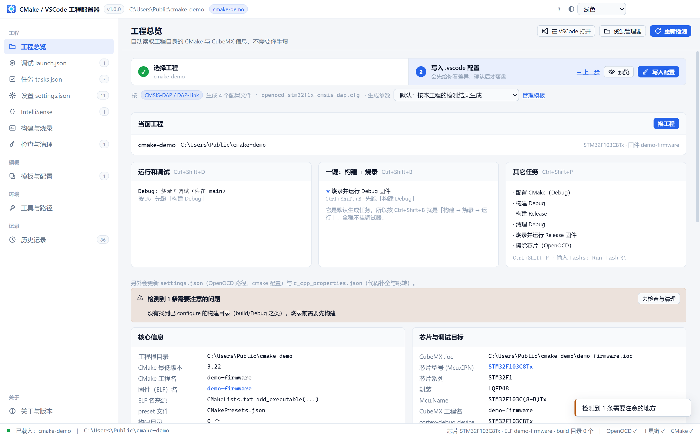

# CV Studio

> **⚠️ 这个软件是 AI 写的**
>
> **代码、界面、文案，以及这份 README、应用里的新手引导、发布说明，全部由 AI 编程助手生成。**
> 作者的活儿是提需求、验收、在自己的板子上试。所以它**能干活，但不要当成经过多年验证的成熟工具**：
> 逻辑里会有 AI 想不到的角落，出错时也会错得很自信。
>
> **文档不用逐字读。** 有 AI 的话，把仓库丢给它、说清楚你想干什么，让它总结比你自己翻快得多。
> 这份 README 就是给「想先看个大概」的人写的；要细节再翻 [详细手册](docs/MANUAL.md)。

**一句话：把一个 CMake 工程读一遍，然后把「在 VSCode 里按 F5 就能调试、按 Ctrl+Shift+B 就能构建烧录」
所需的 `.vscode` 配置全部写好。**

面向 STM32 / Cortex-M，也支持普通 CMake 工程（没有 `.ioc` 也能用）。



---

## 它怎么工作

整个软件就一条主线，六个动作，别的地方都是这条线上的补丁：

| # | 你做的事 | 它做的事 |
| --- | --- | --- |
| 1 | **选工程** | 列出 VSCode 正在打开的、最近打开过的工程给你点；也可以粘贴路径 |
| 2 | **它读工程** | `CMakeLists.txt` 里找 `add_executable()` → 固件名；`CMakePresets.json` 里找 `binaryDir` → 构建目录；`.ioc` 里找 `Mcu.CPN` → 芯片型号；工具链去环境变量 / PATH / 常见安装位置找 |
| 3 | **它判断模式** | 有 `.ioc` → STM32 模式（cortex-debug + OpenOCD + SVD）；没有 → 通用 CMake 模式（cppdbg，MSVC 工程换 cppvsdbg） |
| 4 | **核对** | 把推断结果摊在界面上：芯片、固件、preset、构建目录、工具链、探针。有疑问的地方标黄，但不拦你 |
| 5 | **写入** | 先生成五个文件的内容，给你看**逐文件差异**；确认后落盘，同时存一份快照 |
| 6 | **用起来** | 回到 VSCode：F5 调试、Ctrl+Shift+B 构建烧录。之后想改配置就回这个工具改，不用手撸 JSON |

一句话记法：**选工程 → 核对 → 写入配置**，其余页面都有合理默认值，第一次不用动。

### 它到底写哪五个文件

| 文件 | 作用 | 不写会怎样 |
| --- | --- | --- |
| `launch.json` | 调试配置（先构建 → 烧录 → 停在 `main`） | F5 弹「选择环境」 |
| `tasks.json` | 构建 / 清理 / 烧录任务 | Ctrl+Shift+B 没反应 |
| `settings.json` | OpenOCD 路径、cortex-debug 设置 | 报「openocd 不是内部或外部命令」 |
| `c_cpp_properties.json` | IntelliSense 的包含路径与宏 | 头文件全红波浪线 |
| `openocd-<芯片>-<探针>.cfg` | 接线配置（仅 STM32 模式） | 调试器连不上目标 |

**只写 `.vscode/`，不碰你的源码和 `CMakeLists.txt`。** 唯一例外是你主动用的「源文件管理」——
那是专门给你图形化改 `CMakeLists.txt` 用的，改完同样有差异预览和还原。

### 为什么不怕它写坏

三道保险，都能关，但默认开着：

1. **差异预览** —— 落盘前逐文件 diff，看得见旧内容被换成什么；
2. **写前备份** —— 勾一下，原文件先复制到 `.vscode/.backup/`；
3. **快照还原** —— 每次写入前自动快照（`%APPDATA%\CV Studio\snapshots`，每工程 20 份），
   还原是真还原：连「当时并不存在的文件」也会一并删掉。

---

## 界面地图

左侧导航按**「你在处理什么对象」**分四组，带 ★ 的是日常要用的：

| 分组 | 页面 | 什么时候来 |
| --- | --- | --- |
| 工程 | ★ 配置调试文件 | 选工程、看检测结果、写入配置 —— 90% 的时间在这 |
| | 检查与清理 | 工程改名、构建目录陈旧、配置写歪了，来体检 |
| | 源文件管理 | 有源文件没进构建，勾一下写回 `CMakeLists.txt` |
| | 构建与烧录 | 不想切回 VSCode，就在这儿编译 / 烧录 / 看日志 |
| 配置 | VSCode 配置（4 个 JSON 折叠） | 想手改具体字段时才展开 |
| | 探针与芯片 | 换调试器、改 device、改适配器速度、开 Live Watch |
| | 模板 | 好几个工程想用同一套配置时 |
| 扩展 | 模块包 | VOFA+ 在线调参：扫出工程里的 PID 变量，勾一勾就有波形和可调参数 |
| 系统 | 工具链与路径 | 工具没探测到、换电脑了 |
| | 历史与恢复 | 想「把那个工程照上次再配一遍」 |
| | 关于与版本 | 版本、运行环境、检查更新 |

---

## 安装与升级

到 [Releases](https://github.com/zeal-hope-love/cmake-vscode-studio/releases) 下载最新版：

```
CmakeVscodeStudio-<版本>-setup.exe      自包含安装包，双击选目录即可
CmakeVscodeStudio-<版本>-portable.exe   绿色单文件，自解压到临时目录运行，不写注册表
```

两个版本共用同一份数据目录，绿色版也读得到安装版的设置；放 U 盘或临时机器上用绿色版更省事。

不需要另外装 Node、Electron 或 VSCode 扩展本体（配置生成不依赖扩展；真调试当然要 `cortex-debug`）。

**升级直接覆盖安装同一个目录**，设置、模板、快照、历史都在数据目录里，不会丢：

```
%APPDATA%\CV Studio\
  settings.json    应用设置
  templates.json   模板
  snapshots\       写入前快照
  history.json     操作历史
```

应用启动后会在后台静默查一次 GitHub 上的最新 Release（6 小时缓存，可在设置里关掉）。
有新版本时顶部会出现提示条，「查看更新」会跳到「关于与版本」里的版本卡片 ——
那里能**在应用内下载**安装包，下完直接拉起安装器，不用再开浏览器。

装不装、什么时候装仍然由你决定，**没有静默自动安装**这一说。
绿色版是自解压到临时目录跑的，不参与应用内升级，换版本直接下新的 portable 覆盖即可。

> 从 1.x 升级有改名的历史包袱（安装目录、数据目录都变了，旧目录的数据会自动迁移，
> 但旧版本不会自动卸载），细节见 [详细手册 · 更新与覆盖安装](docs/MANUAL.md#更新与覆盖安装)。

---

## 从源码跑 / 自己打包

```powershell
npm install          # Node ≥ 20
npm run dev          # 开发模式（热更新）
npm run typecheck    # 类型检查
npm run selftest     # 内置自检
```

打包成安装包：

```powershell
npm run dist:setup      # → release/CmakeVscodeStudio-<版本>-setup.exe（自绘安装界面）
npm run dist:portable   # → release/CmakeVscodeStudio-<版本>-portable.exe（绿色单文件）
```

这不是 NSIS 向导，是自己用 Electron 画的安装界面（源码在 `installer/`），
打包流水线在 `tools/build-installer.mjs`：先出应用本体，裁掉用不到的 Electron 运行时文件，
再塞进 payload，最后套一层 portable 外壳压成单文件。
仓库根目录的 `打包成exe.bat` 只是这条命令的壳子。

---

## 出问题了

先看这三处：

- **调试连不上** → 「探针与芯片」里核对 device 和 OpenOCD target；「工具链与路径」里看 OpenOCD 找没找到
- **构建报找不到 `arm-none-eabi-gcc`** → 同上，手动指定工具链路径
- **配置写坏了想退回去** → 「历史与恢复」里还原快照

还不行就提 Issue，把「关于与版本」那一页的信息（版本、Electron/Chromium/Node、平台、数据目录）贴上，
这些能省掉一半来回。常见故障的排查过程在 [docs/TROUBLESHOOTING.md](docs/TROUBLESHOOTING.md)。

---

## 文档

| 文件 | 内容 |
| --- | --- |
| [docs/MANUAL.md](docs/MANUAL.md) | 完整手册：每个页面的字段、检测规则从哪来、为什么这么设计 |
| [docs/DEVELOPMENT.md](docs/DEVELOPMENT.md) | 开发环境、目录结构、打包与签名流程 |
| [docs/TROUBLESHOOTING.md](docs/TROUBLESHOOTING.md) | 踩过的坑与排查方法 |
| [docs/HANDOVER.md](docs/HANDOVER.md) | 交接笔记 |

全部由 AI 写，同样不必逐字看。

## 许可证

见 [LICENSE](LICENSE)。
